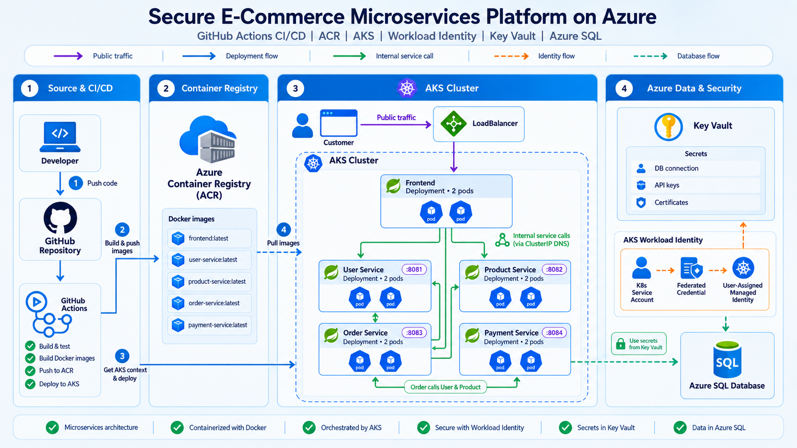
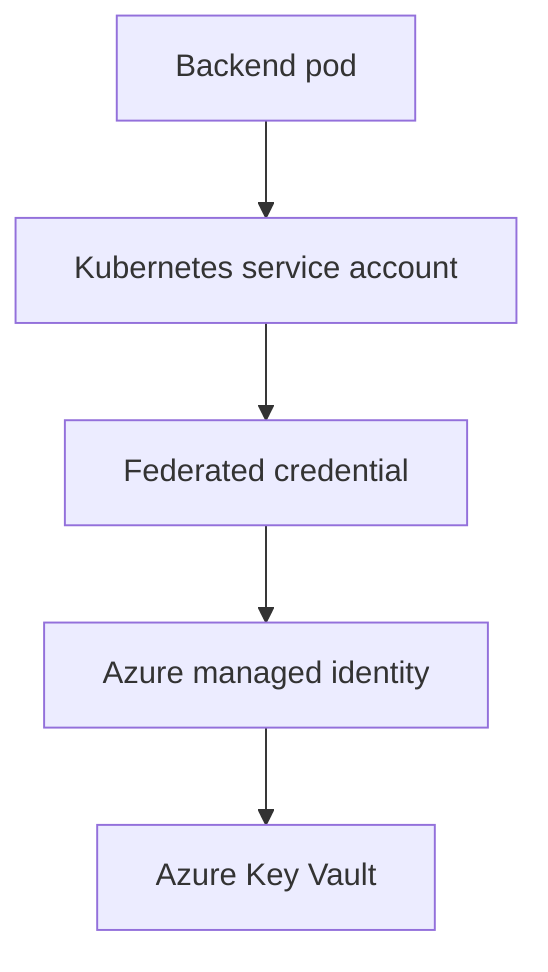
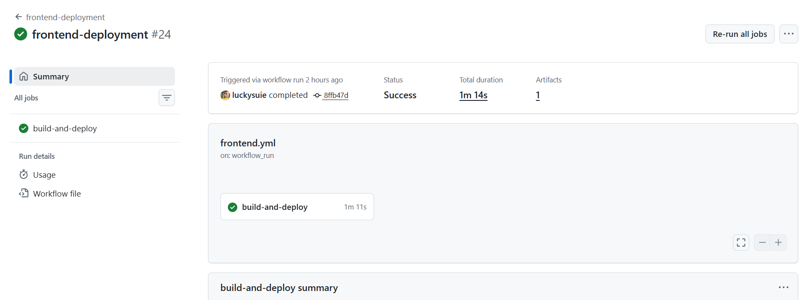
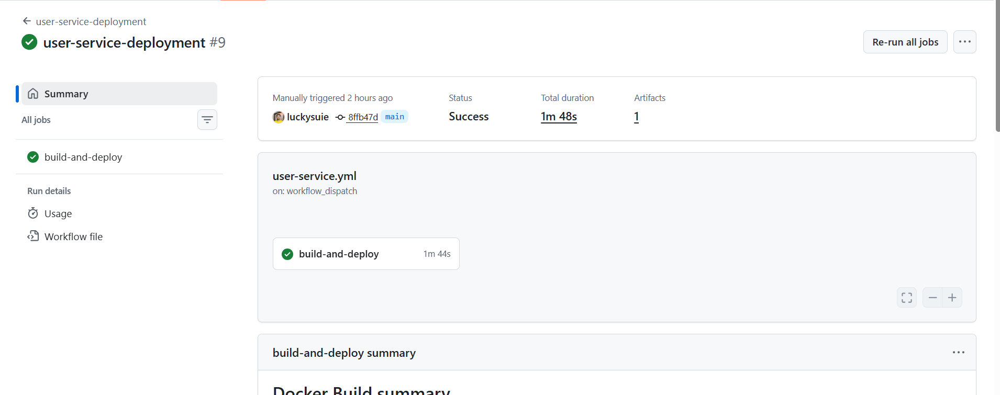
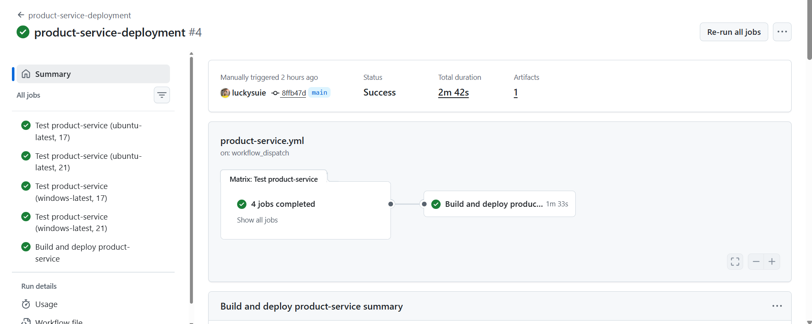
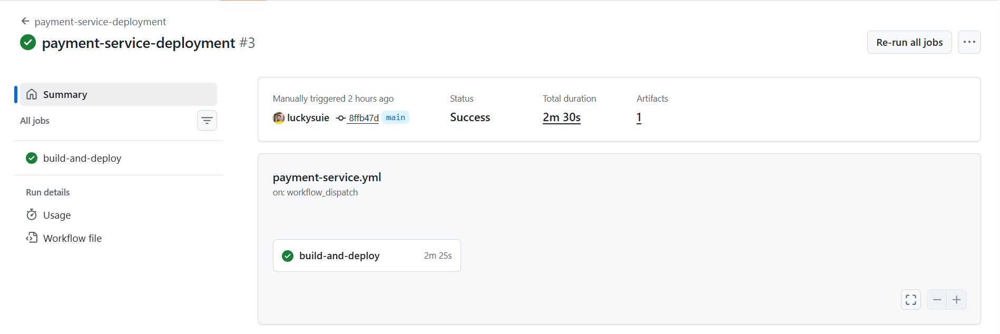
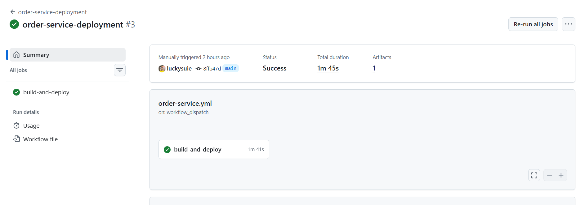
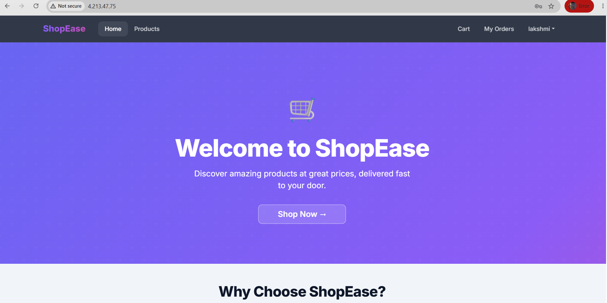
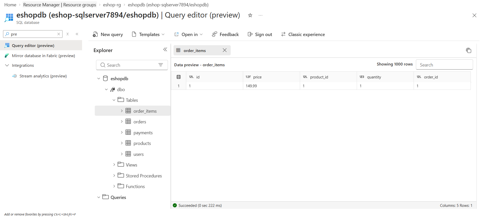

# Secure E-Commerce Java springboot Microservices on Azure AKS with GitHub Actions
  - Automated Container Deployment, Workload Identity, Key Vault and Azure SQL Integration

## Architecture Diagramm


### Monolithic vs Microservices
---
#### 1. Monolithic Application
- Definition: A Monolithic Application is a single application that contains all business functionalities in one codebase, one build, and one deployment unit.
- Example
E-commerce Application

```text
├── Login
├── Products
├── Orders
├── Payments
└── Notifications
```
### Java Spring Boot Repository Structure

```text
ecommerce-monolithic/
├── pom.xml
├── Dockerfile
└── src/
    └── main/java/com/company/ecommerce/
        ├── user/
        ├── product/
        ├── order/
        ├── payment/
        └── EcommerceApplication.java
```

### Build and Deployment
```text
Source Code ---> mvn clean package --> ecommerce.jar --> Single Deployment
```
---

### 2. Microservices Application
- Definition: A Microservices Application is an architecture where the application is divided into multiple small, independent services that communicate with each other through APIs.
### Example
- E-commerce System
```text
User Service
Product Service
Order Service
Payment Service
Notification Service
```

- Each service is an independent Spring Boot application.
### Build Outputs
```text
user-service.jar
product-service.jar
order-service.jar
payment-service.jar
notification-service.jar
```

### Java Spring Boot Repository Structure (Monorepo Approach)
```text
ecommerce-microservices/
├── user-service/
│   ├── pom.xml
│   ├── Dockerfile
│   └── src/
│
├── product-service/
│   ├── pom.xml
│   ├── Dockerfile
│   └── src/
│
├── order-service/
│   ├── pom.xml
│   ├── Dockerfile
│   └── src/
│
├── payment-service/
│   ├── pom.xml
│   ├── Dockerfile
│   └── src/
│
├── notification-service/
│   ├── pom.xml
│   ├── Dockerfile
│   └── src/
│
└── .github/workflows/
    ├── user-service.yml
    ├── product-service.yml
    ├── order-service.yml
    ├── payment-service.yml
    └── notification-service.yml
```

### Build and Deployment
```text
user-service --> user-service.jar --> Deploy Independently
product-service --> product-service.jar --> Deploy Independently
```
---
#### What is an API?
- An API is a way for one application or service to talk to another application or service.
### Simple meaning
```text
Service A needs data
     ↓
Calls API
     ↓
Service B gives response
```
### Example
- Suppose we have:
```text
User Service
Product Service
Order Service
```
- Customer places an order.
- order-service needs user details and product details.
- So it calls APIs:

```text
order-service --> GET /users/101 --> user-service
```
- Response:
```json
{
  "id": 101,
  "name": "Lucky"
}
```
- Then:
```text
order-service --> GET /products/500 --> product-service
```
- Response:

```json
{
  "id": 500,
  "name": "iPhone",
  "price": 1000
}
```
- Now order-service can create the order.

---

### How APIs work inside AKS cluster
- Inside AKS, each microservice runs as a pod.

```text
AKS Cluster

user-service pod
product-service pod
order-service pod
```
- Kubernetes also creates service names like:

```text
user-service
product-service
order-service
```
- So order-service can call:
```text
http://user-service/users/101
```
- and:

```text
http://product-service/products/500
```
---

#### Microservices communication in AKS
```text
Customer
  ↓
API Gateway / Frontend
  ↓
order-service pod
  ↓
  ├── calls user-service API
  │       GET http://user-service/users/101
  │
  └── calls product-service API
          GET http://product-service/products/500
```

#### Simple understanding
- In AKS, microservices communicate through APIs using Kubernetes service names instead of IP addresses.

### steps
1. Fork the repo to your Github account. url: https://github.com/luckysuie/eshop-microservices 
2. Open the forked repo in your local machine using visual studio code

### Provision Infrastructure using Azure CLI or portal
1. create a resouce group in the central india region or any other region of your choice.
```bash
 az group create --name eshop-rg --location CentralIndia
```

2. create an sql server with admin username and password.
```bash
az sql server create --name eshop-sqlserver7894 --resource-group eshop-rg --location CentralIndia --admin-user adminuser --admin-password AdminPassword123!
```
3. create an azrure sql database with the name of your choice in the sql server created in step 2.
```bash
az sql db create --resource-group eshop-rg --server eshop-sqlserver7894 --name eshopdb --service-objective S0
```

4. create an firewall rule to allow your local machine to access the database.
```bash
az sql server firewall-rule create --resource-group eshop-rg --server eshop-sqlserver7894 --name AllowYourIP --start-ip-address  49.43.220.89 --end-ip-address  49.43.220.89  ## Replace with your actual system IP address to allow access to the SQL Server from your machine
```
5. Create anoother firewall rule to allow azure services to access the database.
```bash
az sql server firewall-rule create --resource-group eshop-rg --server eshop-sqlserver7894 --name AllowAzureServices --start-ip-address  0.0.0.0 --end-ip-address  255.255.255.255
```
6. create an azure key vault named eshop-kv7894 or any other unique name in the above resource group
```bash
az keyvault create --name eshop-kv7894 --resource-group eshop-rg --location CentralIndia
```
- Imp Note: since the keyvault name is globally unique, you can use any other name of your choice and it should match in the application.properties file of the microservices.

### Assign kevault administrator to the signed-in user for the keyvault created in step 5.
1. Get the object id of the signed-in user and store in a variable.
```bash
USER_OBJECT_ID=$(az ad signed-in-user show --query id -o tsv)  ## Get the object ID of the signed-in user and store it in a variable
```
2. Get the resource id of the keyvault created in step 5 and store in a variable.
```bash
KV_ID=$(az keyvault show --name eshop-kv7894 --resource-group eshop-rg --query id -o tsv)  ## Get the resource ID of the Key Vault and store it in a variable
```
3. Assign the keyvault administrator role to the signed-in user using the object id and resource id stored in the above steps.
```bash
az role assignment create --assignee $USER_OBJECT_ID --role "Key Vault Administrator" --scope $KV_ID  ## Assign the Key Vault Administrator role to the signed-in user for the Key Vault
```

### store the database credentials in the keyvault created in step 5.
1. Store the database jdbc url in the keyvault as a secret with the name db-url.
```bash
az keyvault secret set --vault-name eshop-kv7894 --name "db-url" --value "jdbc:sqlserver://eshop-sqlserver7894.database.windows.net:1433;database=eshopdb;encrypt=true;trustServerCertificate=false;hostNameInCertificate=*.database.windows.net;loginTimeout=30;"
```
2. Store the database username in the keyvault as a secret with the name db-username.
```bash
az keyvault secret set --vault-name eshop-kv7894 --name "db-username" --value "adminuser"
```
3. Store the database password in the keyvault as a secret with the name db-password.
```bash
az keyvault secret set --vault-name eshop-kv7894 --name "db-password" --value "AdminPassword123!"
```
- Note: Before going to the next step, make sure the keyvault name in the application.properties file of the microservices matches with the keyvault name created in step 5 if not please update the application.properties file of the microservices with the correct keyvault name.

### Create an ACR and AKS cluster using Azure CLI or portal
1. Create an Azure Container Registry (ACR) in the same resource group with admin access enabled
```bash
az acr create --resource-group eshop-rg --name eshopacr7894 --sku Basic --admin-enabled true --output json
```
2. Create an AKS cluster in the same resource group created in step 2 and attach the ACR created in step 1 to the AKS cluster.
```bash
az aks create --resource-group eshop-rg --name eshop-aks7894 --node-count 1 --generate-ssh-keys --attach-acr eshopacr7894
```

### Configure Azure Workload Identity for AKS Pods to Securely Access Azure Key Vault
- It allows your backend pods to access Azure Key Vault securely without storing Azure usernames, passwords, or service-principal secrets inside Kubernetes.

- Why was it needed?
  - Your backend services need database credentials:
```bash
db-url
db-username
db-password
```
  - Those secrets are stored in Azure Key Vault. Therefore, the backend pods need a secure identity and permission to read them.

- Authentication flow:

- Enabled Workload Identity
  - Enables Workload Identity on the AKS cluster so pods can securely authenticate with Azure services.
```bash
az aks update \
  --resource-group eshop-rg \
  --name eshop-aks7894 \
  --enable-workload-identity
```
  
- Verify the identity is created for the AKS cluster
  - Verifies that OIDC and Workload Identity are enabled on the AKS cluster.
```bash
az aks show \
  --resource-group eshop-rg \
  --name eshop-aks7894 \
  --query "{workloadIdentity:securityProfile.workloadIdentity.enabled,oidc:oidcIssuerProfile.enabled}"
```

- Create a managed identity
  - Creates a user-assigned managed identity that the backend microservices will use to access Azure Key Vault.
```bash
az identity create \
  --name eshop-workload-identity \
  --resource-group eshop-rg \
  --location centralindia
```

- capture its details in variables
  - Stores the managed identity’s client ID, principal ID, and the AKS OIDC issuer URL in shell variables.
```bash
IDENTITY_CLIENT_ID=$(az identity show \
  --name eshop-workload-identity \
  --resource-group eshop-rg \
  --query clientId -o tsv)

IDENTITY_PRINCIPAL_ID=$(az identity show \
  --name eshop-workload-identity \
  --resource-group eshop-rg \
  --query principalId -o tsv)

AKS_OIDC_ISSUER=$(az aks show \
  --name eshop-aks7894 \
  --resource-group eshop-rg \
  --query oidcIssuerProfile.issuerUrl -o tsv)
```
- Confirm they are populated:
  - Displays the stored variable values to confirm that they were retrieved successfully.
```bash
echo "$IDENTITY_CLIENT_ID"
echo "$IDENTITY_PRINCIPAL_ID"
echo "$AKS_OIDC_ISSUER"
```
- Create service account for the backend pods
  - Creates a Kubernetes service account named `ecommerce-workload-identity-sa` in the default namespace.
```bash
kubectl create serviceaccount ecommerce-workload-identity-sa \
  --namespace default
```
- Annotate the service account with the managed identity’s client ID
  - Associates the Kubernetes service account with the Azure managed identity by adding an annotation.
```bash
kubectl annotate serviceaccount ecommerce-workload-identity-sa \
  --namespace default \
  azure.workload.identity/client-id="$IDENTITY_CLIENT_ID"
```
- Verify the annotation is applied:
  - Verifies that the managed identity client ID annotation was added to the Kubernetes service account.
```bash
kubectl get serviceaccount ecommerce-workload-identity-sa \
  --namespace default \
  -o yaml
```
- Create the federated credential
  - Creates a federated credential that allows the Kubernetes service account to authenticate as the Azure managed identity.
```bash
az identity federated-credential create \
  --name eshop-federated-credential \
  --identity-name eshop-workload-identity \
  --resource-group eshop-rg \
  --issuer "$AKS_OIDC_ISSUER" \
  --subject "system:serviceaccount:default:ecommerce-workload-identity-sa" \
  --audiences "api://AzureADTokenExchange"
```
- Give the identity access to Key Vault
  - Retrieves the Azure Key Vault resource ID and stores it in the KEYVAULT_ID variable.
```bash
KEYVAULT_ID=$(az keyvault show \
  --name eshop-kv7894 \
  --resource-group eshop-rg \
  --query id -o tsv)
```
- Assign the Key Vault Secrets User role to the managed identity
  - Assigns the Key Vault Secrets User role so the managed identity can read secrets from Azure Key Vault
```bash
az role assignment create \
  --assignee-object-id "$IDENTITY_PRINCIPAL_ID" \
  --assignee-principal-type ServicePrincipal \
  --role "Key Vault Secrets User" \
  --scope "$KEYVAULT_ID"
```
- Confirm
  - Confirms that the Key Vault role assignment was successfully created for the managed identity.
```bash
az role assignment list \
  --assignee "$IDENTITY_PRINCIPAL_ID" \
  --scope "$KEYVAULT_ID" \
  --output table
```

### service principal creation and role assignment
1. Create a service principal and store the appId, password, and tenant in variables.
2. Assign the service principal as contributor role at subscription level
```bash
az ad sp create-for-rbac --name "eshop-github-actions" --role contributor --scopes /subscriptions/<subscription-id> --sdk-auth  ## Replace <subscription-id> with your actual Azure subscription ID
```
3. store the clientId, clientSecret, subscriptionId, and tenantId in the github secrets of the forked repo as variable AZURE_CREDENTIALS in the below format:
```json
{
  "clientId": "yourclientid",
  "clientSecret": "yoursecret",
  "subscriptionId": "yoursubsctiptionid",
  "tenantId": "yourtenatid"
}
```
- Clone the forked repository into local and open it in visual studio code and start writing the files


## Writing Yaml files(deployment and service) for frontend and backend microservices
0. Before writing the yaml files, the repository whatever you have forked contains all these files which are written you can use them as reference and modify them according to your requirements. The files are located in the k8s folder of the repository if not delete them and create new files with the below instructions.
1. Navigate to the frontend folder insde the k8s folder and write the deployment and service yaml files with below hints
- deployment.yaml
  - create a kubernetes deployment manifest using apiversion: apps/v1 and se the application name as frontend
  - configure the deployment to run the 2 replicas of the frontend application
  - use labels and selectors properly so that the deployment can identify pods with app: frontend
  - Add one container named frontend, use the frontend image from Azure Container Registry, and expose container port 80
  - Add basic CPU/memory requests, limits, liveness probe, and readiness probe to make the frontend pod production-ready.
    
- service.yaml
  - Create a Kubernetes Service manifest using apiVersion: v1 and kind: Service.
  - set the Service name as frontend and use the label app: frontend.
  - Configure the selector so the Service can connect to pods with app: frontend.
  - Expose the Service on port 80 and forward traffic to container targetPort: 80.
  - Use type: LoadBalancer so the frontend application gets a public IP address.

2. For backend services below are the hints
- Create a Kubernetes Deployment for each backend service such as user-service, product-service, order-service, and payment-service.
- Use proper service names, labels, and selectors. The metadata.name, labels.app, selector.matchLabels.app, and pod labels.app should match the microservice name.
- Configure each Deployment with 2 replicas and use the correct Docker image from Azure Container Registry.
- Expose the correct container port for each service:
    ````text
    user-service: 8081
    product-service: 8082
    order-service: 8083
    payment-service: 8084
    ``
- Since backend services use Azure Workload Identity, include this label inside pod template metadata:
    ``` bash azure.workload.identity/use: "true" ```
- Also include the service account name inside pod spec because the services may need to access Azure resources like Key Vault:
    ```bash serviceAccountName: ecommerce-workload-identity-sa ```
- Add resource requests and limits for CPU and memory so the pods have controlled resource usage.
- Add liveness and readiness probes using the Spring Boot health endpoint: ```bash /actuator/health ```
- Create a separate Kubernetes Service for each backend microservice.
- Use type: ClusterIP for backend services because they should be accessible only inside the AKS cluster, not directly from the internet.

## writing GitHub Actions workflow files for frontend and backend microservices
0. Before writing the yaml files, the repository whatever you have forked contains all these files which are written you can use them as reference and modify them according to your requirements. The files are located in the workflows folder of the repository if not delete them and create new files with the below instructions. 

- Hints: User Service Deployment Workflow
  - Configure the workflow to run when user-service code, Kubernetes manifests, or its workflow file changes on the main branch. Include a manual trigger for testing.
  - Define environment variables for the Azure Container Registry, user-service image, AKS cluster, and Azure resource group.
  - Check out the repository, authenticate with Azure using the GitHub secret, and log in to the Azure Container Registry.
  - Build the Docker image using the user-service directory and Dockerfile, then push it to ACR using the latest tag.
  - Connect to the AKS cluster, apply the user-service Deployment and Service manifests, and verify the Kubernetes service using kubectl.

- Hints: Product Service Deployment Workflow
  - Trigger the workflow when product-service source code, Kubernetes manifests, or its workflow file changes on the - main branch. Also allow manual execution.
  - Create a test job that uses a matrix strategy to test the service with Java 17 and 21 on both Ubuntu and Windows runners.
  - Check out the repository, configure the required Temurin Java version, and run the Maven test lifecycle from the product-service directory.
  - Make the build-and-deploy job depend on the successful completion of all matrix test combinations. Then authenticate with Azure, build the product-service Docker image, and push it to ACR.
  - Set the AKS cluster context, apply the product-service Deployment and Service manifests, and verify the deployed Kubernetes service with kubectl.

- Hints: Payment Service Deployment Workflow
  - Configure the workflow to run when payment-service source code, Kubernetes manifests, or its workflow file changes on the main branch. Also allow manual execution.
  - Set up Java 17 using the Temurin distribution and cache Maven dependencies to make future workflow runs faster.
  - Run the Maven tests from the payment-service directory. Continue with the deployment only when all tests pass.
  - Authenticate with Azure, log in to Azure Container Registry, build the payment-service Docker image, and push it using the latest tag.
  - Connect to the AKS cluster, apply the payment-service Deployment and Service manifests, and verify the deployed service using kubectl.

- Hints: Order Service Deployment Workflow
  - Configure the workflow to run when order-service source code, Kubernetes manifests, or its workflow file changes on the main branch. Also allow manual execution.
  - Define reusable environment variables for the Azure Container Registry, order-service image, AKS cluster, and Azure resource group.
  - Check out the repository, authenticate with Azure using the configured GitHub secret, and log in to Azure Container Registry.
  - Build the Docker image using the order-service directory and its Dockerfile, then push it to ACR using the latest tag.
  - Connect to the AKS cluster, apply the order-service Deployment and Service manifests, and verify the deployed Kubernetes service using kubectl.

- Hints: Frontend Deployment Workflow
  - Configure the workflow to run after all backend service deployment workflows complete successfully. Also support frontend-related pushes to main and manual execution.
  - Define reusable environment variables for the Azure Container Registry, frontend image, AKS cluster, and Azure resource group.
  - Add a condition so deployment proceeds only for a successful backend workflow run, a valid push event, or a manual trigger.
  - Authenticate with Azure, sign in to the container registry, then build the frontend image from its Dockerfile and push it with an appropriate tag.
  - Connect to the AKS cluster, apply the frontend Kubernetes Deployment and Service manifests, and verify the deployed services using kubectl.

- once all the files has written push them to the Github reposiory
```bash
git init
git add .
git commit -m "Add CI/CD workflows for frontend and backend services"
git push origin main
```
- once pushed the workflows will run if not run the workflows manually start from backend services then finally run the frontend
- Get the frontend cluster ip address using below command by running it in the cloud shell
```bash
kubectl get pods --all-namespaces
```
- Browse the ip address with http:yourclusterip. It should show your page
- Register on the top rightside of the application
- try to add some items in the cart

### Verifications and successions
- Frontend succesfull
  

- user-service succesfull
  

- product-service succesfull
  

- payment-service succesfull
  

- orde-service succesfull
  

- Application
  

- Database storing
  