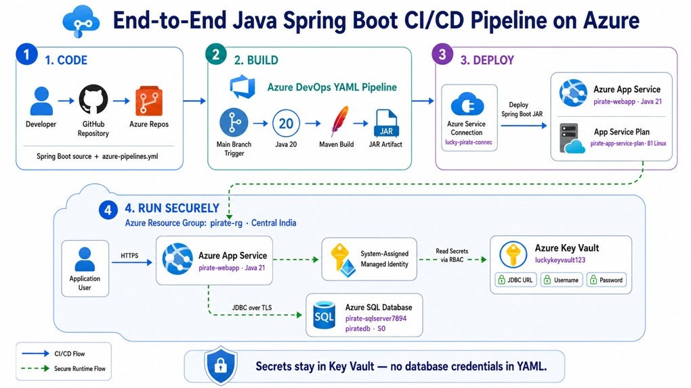

### End-to-End CI/CD Deployment of a Java Spring Boot Application to Azure App Service using Azure DevOps, Key Vault, and Azure SQL using YAML pipeline and Azure CLI


#### Architecture Diagram

- Project Setup Steps
    1.	Create a New Project in Azure DevOps
        - Navigate to the Azure DevOps portal.
        - Create a New Project with your preferred name.
    2.	Import the Repository
        - Go to Repos in the project.
        - Click the top dropdown → Import Repository.
        - Use the following repository URL:
        - Repository: https://github.com/luckysuie/quickstart-spring-data-jdbc-sql-server

- Azure Infra setup
  1. Create a Resource Group
```bash
az group create --name pirate-rg --location CentralIndia
```
2. Create an Azure SQL Servers
```bash
az sql server create --name pirate-sqlserver7894 --resource-group pirate-rg --location CentralIndia --admin-user adminuser --admin-password AdminPassword123!
```

- Note: To REgister the SQL server
```bash
az provider register --namespace Microsoft.Sql
```

3. Create an Azure SQL Database and firewall rules
```bash
az sql db create --resource-group pirate-rg --server pirate-sqlserver7894 --name piratedb --service-objective S0
az sql server firewall-rule create --resource-group pirate-rg --server pirate-sqlserver7894 --name AllowAzureServices --start-ip-address  0.0.0.0 --end-ip-address  255.255.255.255
az sql server firewall-rule create --resource-group pirate-rg --server pirate-sqlserver7894 --name AllowYourIP --start-ip-address  49.43.221.195 --end-ip-address  49.43.221.195  ## Replace with your actual system IP address to allow access to the SQL Server from your machine
```
- Note: To Register the Key Vault
```bash
az provider register --namespace Microsoft.KeyVault
```
4. Create an Azure Key Vault
```bash
az keyvault create --name luckykeyvault12334 --resource-group pirate-rg --location CentralIndia
```
5. Assign Key Vault Administrator role to the signed-in user for the Key Vault
```bash
USER_OBJECT_ID=$(az ad signed-in-user show --query id -o tsv)  ## Get the object ID of the signed-in user and store it in a variable
KV_ID=$(az keyvault show --name luckykeyvault12334 --resource-group pirate-rg --query id -o tsv)  ## Get the resource ID of the Key Vault and store it in a variable
az role assignment create --assignee $USER_OBJECT_ID --role "Key Vault Administrator" --scope $KV_ID  ## Assign the Key Vault Administrator role to the signed-in user for the Key Vault
```

6. Store the database credentials in the Key Vault
```bash
az keyvault secret set --vault-name luckykeyvault12334 --name "spring-datasource-url" --value "jdbc:sqlserver://pirate-sqlserver7894.database.windows.net:1433;database=piratedb;encrypt=true;trustServerCertificate=false;hostNameInCertificate=*.database.windows.net;loginTimeout=30;"

az keyvault secret set --vault-name luckykeyvault12334 --name "spring-datasource-username" --value "adminuser"

az keyvault secret set --vault-name luckykeyvault12334 --name "spring-datasource-password" --value "AdminPassword123!"
```
az provider register --namespace Microsoft.Web
7. Create an azure webapp with the following
```bash
az appservice plan create --name pirate-app-service-plan --resource-group pirate-rg --sku B1 --is-linux
az webapp create --name pirate-webapp --resource-group pirate-rg --plan pirate-app-service-plan --runtime "JAVA|11-java11"
az webapp config set --name pirate-webapp --resource-group pirate-rg --linux-fx-version "JAVA|21-java21"
```

### this command configures your deployed Spring Boot application to run using Azure-specific settings and tells it which Azure Key Vault to use.
```bash
az webapp config appsettings set --name pirate-webapp --resource-group pirate-rg --settings AZURE_KEYVAULT_ENDPOINT=https://luckykeyvault12334.vault.azure.net/
```

### This command enables a System Assigned Managed Identity for the Azure App Service, allowing it to securely authenticate with Azure services like Key Vault without storing credentials.
```bash
az webapp identity assign --name pirate-webapp --resource-group pirate-rg 
```

### Assign the Key Vault Secrets User role to the web app's managed identity for accessing secrets in Key Vault
```bash
APP_PRINCIPAL_ID=$(az webapp show --name pirate-webapp --resource-group pirate-rg --query identity.principalId -o tsv)
KV_ID=$(az keyvault show --name luckykeyvault12334 --resource-group pirate-rg --query id -o tsv)
az role assignment create --assignee-object-id $APP_PRINCIPAL_ID --assignee-principal-type ServicePrincipal --role "Key Vault Secrets User" --scope $KV_ID
```

8. Create a service principal for Azure DevOps to access Azure resources
```bash
az ad sp create-for-rbac --name "pirate-devops-sp" --role contributor --scopes /subscriptions/<subscription-id> --sdk-auth  ## Replace <subscription-id> with your actual Azure subscription ID
``` 

### save the below in the notepad
```bash
{
  "clientId": "your-client-id",
  "clientSecret": "your-client-secret",
  "subscriptionId": "your-subscription-id",
  "tenantId": "yourtenantid"
}
``` 

- Azure DevOps Pipeline Setup
0. Navigate to your Azure DevOps project
1. Create an azure service connection for Azure DevOps to access Azure resources
    - Project settings-->service connections--> New service Connection--> Azure Resource Manager
    - Identity Type: App registration or managed identity(manual)
    - credential: secret
    - Environment: Azure cloud
    - scope level: subscription
    - subscription ID: you-subscription-ID
    - subscription name: your subscription name
    - application(client ID): your applicationclientID
    - Directory(tenant)ID: your directory TenantID
    - credential-->service principal key
    - client secret : password-your-client-secret
    - service connection Name: lucky-pirate-connec
2. Create a new pipeline in Azure DevOps
    - Navigate to Pipelines in the Azure DevOps project.
    - Click on "New Pipeline" and select your repository.
    - Choose "YAML" as the pipeline configuration method.
    - start writng the pipeline with besslow stages
    - Yaml file is already shared in the repo